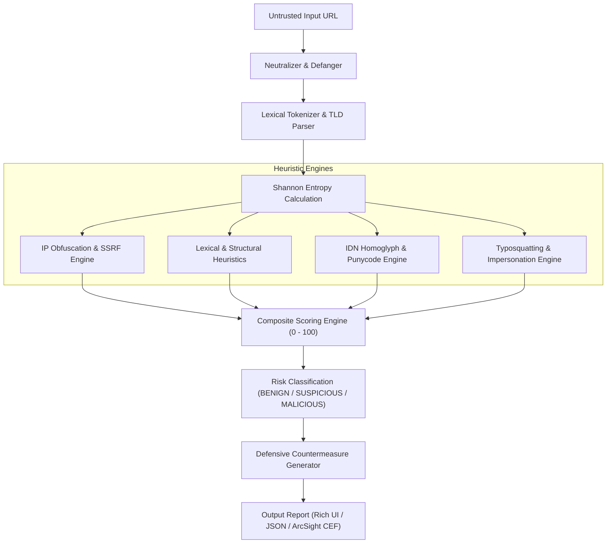

# Phishing URL & Domain Threat Intelligence Analyzer

[](https://github.com/Krish9800/phishing-url-analyzer/actions)
[](https://www.python.org/downloads/)
[]()
[](https://github.com/astral-sh/ruff)
[](https://github.com/PyCQA/bandit)
[](LICENSE)

A high-performance, defensive threat intelligence tool for dissecting suspect URLs and domains to uncover phishing infrastructure, homoglyph visual spoofing, IP obfuscation techniques, and brand impersonation.

Designed for **SOC Analysts**, **Incident Responders**, **Threat Hunters**, and **SOAR automation pipelines**, the analyzer operates **strictly offline without making external HTTP connections or DNS requests**, ensuring analyst telemetry is never leaked.

---

## Key Capabilities

- **Zero-Network Lexical Dissection**: Safely processes URLs locally; zero outbound traffic or DNS queries.
- **Automated Defanging**: Converts dangerous indicators (`http://`, `.`) to neutralized artifacts (`hxxp://`, `[.]`).
- **Shannon Entropy Analysis**: Detects Algorithmically Generated Domains (DGAs) and encrypted tokens.
- **IP Obfuscation & SSRF Detection**: Unmasks Dword integers (`http://2130706433`), hexadecimal (`0x7f000001`), and octal IPs, while flagging private and cloud metadata addresses.
- **IDN Homoglyph & Punycode Detection**: Uncovers Unicode visual spoofing across Cyrillic and Greek character sets targeting protected brands.
- **Typosquatting & Brand Impersonation**: Uses space-efficient Levenshtein distance, l33tspeak normalization, and compound domain pattern matching.
- **SIEM & SOAR Integration**: Native export to **ArcSight Common Event Format (CEF)** and JSON.
- **Dual Operations**: Available as an interactive CLI or a containerized REST API microservice.

---

## Architecture



---

## Installation

### Prerequisites
- Python 3.12+
- `pip` or `uv`

### Local Virtual Environment
```bash
git clone https://github.com/Krish9800/phishing-url-analyzer.git
cd phishing-url-analyzer

python -m venv .venv
source .venv/bin/activate
pip install -e ".[dev]"
```

---

## CLI Usage

### 1. Analyze a Single URL
```bash
# Rich Terminal Visual Output
phish-analyzer analyze "http://pаypal.com/signin"

# Output Machine-Readable JSON
phish-analyzer analyze "http://0x7f000001/status" --json

# Output ArcSight CEF Syslog Format
phish-analyzer analyze "http://verify-account.tk/login" --cef

# Disable Automatic Defanging
phish-analyzer analyze "https://example.com" --no-defang
```

### 2. Batch Analysis
Process multiple URLs from a threat feed file:
```bash
phish-analyzer batch suspicious_urls.txt --output triage_results.jsonl
```

### 3. Display Version
```bash
phish-analyzer version
```

---

## REST API Usage

Start the REST API server:
```bash
uvicorn phish_analyzer.api.app:app --host 0.0.0.0 --port 8000
```

### Endpoints

| Method | Endpoint | Description |
| :--- | :--- | :--- |
| `GET` | `/health` | Service health status and metadata |
| `POST` | `/api/v1/analyze` | Single URL threat evaluation |
| `POST` | `/api/v1/analyze/batch` | Bulk evaluation (up to 200 URLs) |
| `POST` | `/api/v1/defang` | Neutralize a suspicious URL |

#### Example: Analyze URL
```bash
curl -X POST http://localhost:8000/api/v1/analyze \
  -H "Content-Type: application/json" \
  -d '{"url": "http://0x7f000001/malware.exe"}'
```

**Response:**
```json
{
  "raw_url": "http://0x7f000001/malware.exe",
  "defanged_url": "hxxp://0x7f000001/malware[.]exe",
  "threat_score": 70,
  "risk_level": "MALICIOUS",
  "parsed_url": {
    "hostname": "0x7f000001",
    "has_ip_host": true,
    "domain_entropy": 2.75,
    "path_entropy": 3.1
  },
  "triggers": [
    {
      "rule_id": "OBFUSCATED_IP_HOST",
      "name": "Hexadecimal Obfuscated IP Address",
      "severity": "CRITICAL",
      "score_weight": 35,
      "description": "Host uses hexadecimal notation (0x7f000001) resolving to 127.0.0.1.",
      "evidence": "normalized_ip='127.0.0.1'"
    }
  ],
  "recommendations": [
    "Block host at network firewall; inspect internal traffic for SSRF or C2 beaconing attempts."
  ],
  "analyzed_at": "2026-10-06T10:00:00Z"
}
```

---

## Docker Deployment

### Run Container via Docker
```bash
# Build rootless multi-stage image
docker build -t phish-analyzer:latest .

# Run container with read-only rootfs
docker run -d \
  --name phish-analyzer \
  --read-only \
  --security-opt no-new-privileges:true \
  --tmpfs /tmp:rw,noexec,nosuid,size=64m \
  -p 8000:8000 \
  phish-analyzer:latest
```

### Docker Compose
```bash
docker compose up -d
```

---

## DevSecOps & Quality Assurance

Run the comprehensive local verification suite:
```bash
# 1. Formatting
ruff format --check .

# 2. Linting
ruff check .

# 3. Static Type Analysis
mypy src tests

# 4. SAST Security Scan
bandit -r src/

# 5. Unit, Integration, & Adversarial Test Suite
pytest tests/ --cov=phish_analyzer --cov-report=term-missing --cov-fail-under=90
```

---

## Security & Responsible Disclosure

This tool is designed exclusively for defensive security operations, threat intelligence collection, and educational analysis. Please refer to [SECURITY.md](SECURITY.md) for vulnerability reporting procedures.

---

## License

Distributed under the [MIT License](LICENSE).
