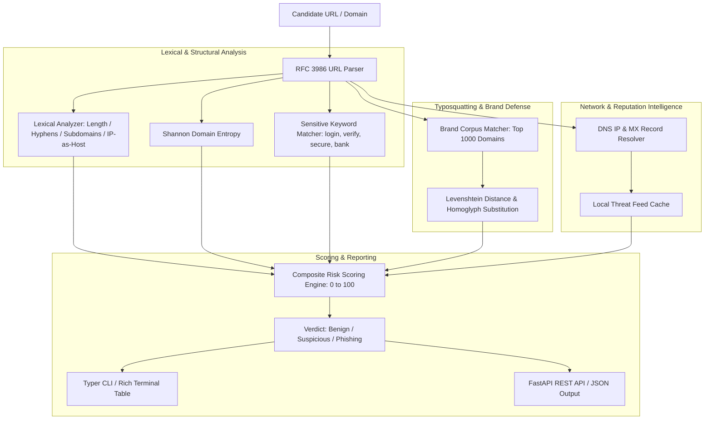

# Phishing URL & Domain Threat Intelligence Analyzer (`phish-analyzer`)

Advanced Lexical, Heuristic, and Domain Reputation Threat Intelligence Analyzer for Malicious URLs and Typosquatting Detection.

[](https://github.com/Krish9800/phishing-url-analyzer/actions)
[](LICENSE)
[](https://www.python.org/)
[](https://typer.tiangolo.com/)
[](https://datatracker.ietf.org/doc/html/rfc3986)

---

## Overview & Problem Statement

Phishing attacks remain the predominant initial access vector for credential theft and malware delivery. Attackers engineer deceptive domain names utilizing homoglyph substitutions, excessive subdomains, brand typosquatting, and deceptive path structures to trick users and bypass simple blocklists.

**Phishing URL Analyzer** is a high-speed, multi-tier threat intelligence utility. It decomposes URLs into lexical, structural, and network components, calculates Levenshtein distance against high-profile target brands, analyzes domain registration age, inspects redirect chains, and computes a composite **Phishing Risk Score** from 0 to 100.

---

## Architecture & Data Flow



---

## Verified Features

- **Lexical & Syntactic Analysis:** Analyzes URL length, excessive subdomains, presence of IP address in hostnames, `@` symbol credential tricks, and non-standard port numbers.
- **Typosquatting & Homoglyphs:** Compares candidate domains against top global brands using Levenshtein distance and character-replacement heuristics (e.g. `paypa1.com`, `g00gle.com`).
- **Shannon Domain Entropy:** Calculates randomness score to identify algorithmically generated domains (DGA) used by C2 droppers.
- **Sensitive Keyword Correlation:** Detects deception patterns combining brand names with sensitive security keywords (`secure-login-account-update`).
- **Batch Processing:** High-throughput batch scanning of CSV and text lists with multi-threaded worker pools.
- **Dual Interface:** Typer CLI formatting with color-coded risk metrics, plus a FastAPI REST backend.

---

## Technology Stack

- **Runtime:** Python 3.12+
- **Network Resolution:** `dnspython` & `httpx`
- **Data Validation:** Pydantic v2
- **CLI Framework:** Typer & Rich
- **API Framework:** FastAPI & Uvicorn
- **Testing:** Pytest, Ruff, Mypy, Bandit

---

## Requirements & Installation

```bash
# Clone the repository
git clone https://github.com/Krish9800/phishing-url-analyzer.git
cd phishing-url-analyzer

# Create and activate virtual environment
python3 -m venv .venv
source .venv/bin/activate

# Install dependencies
pip install -e .
```

---

## Verified Usage Examples

### 1. Command-Line Interface (CLI)

```bash
# Analyze a single URL for phishing indicators
phish-analyzer analyze "https://secure-login.paypa1.com.account-update.xyz/login.php"

# Batch scan a list of candidate URLs from file
phish-analyzer batch suspicious_urls.txt --format json --output results.json

# Check version and active threat heuristics
phish-analyzer version
```

Sample Detection Output:
```
[!] PHISHING VERDICT: HIGH RISK (Score: 88/100)
  Domain: secure-login.paypa1.com.account-update.xyz
  - Typosquatting target detected: 'paypal.com' (Levenshtein distance: 1)
  - Sensitive security keywords present: ['secure', 'login', 'account', 'update']
  - Excessive subdomain depth: 4 levels
  - High TLD risk weight: '.xyz'
```

### 2. REST API Service

```bash
# Launch the API daemon
uvicorn phish_analyzer.api.app:app --host 127.0.0.1 --port 8000
```

Endpoints available at `http://127.0.0.1:8000/docs`:
- `POST /api/v1/analyze` — Submit URL for real-time risk assessment
- `POST /api/v1/batch` — Submit batch array of URLs

---

## Testing & Quality Gates

```bash
# Run unit and lexical analysis tests
pytest --cov=phish_analyzer --cov-report=term-missing

# Linting and static analysis
ruff check .
ruff format --check .
mypy src/phish_analyzer
```

---

## Security Model & Threat Boundaries

- **Safe Offline Inspection:** Lexical and entropy calculations run strictly in memory without navigating to or rendering remote HTML/JavaScript payloads, eliminating browser drive-by download risks.
- **Privacy-Preserving Queries:** Domain reputation lookups query local hash caches and public DNS records; user query history is never sent to third-party commercial APIs.

---

## Limitations & Known Issues

- **Cloaking Evasion:** Attackers employing geo-IP cloaking or CAPTCHAs to serve benign content to security scanners are evaluated via URL lexical properties rather than live web rendering.
- **Shortened URLs:** Multi-hop shortened links (`bit.ly`, `t.co`) are expanded safely via HTTP HEAD redirects, but unresolvable dead links are evaluated on structural features only.

---

## License & Responsible Use

This project is licensed under the **MIT License** — see the [LICENSE](LICENSE) file for details.

> [!NOTE]
> Designed for SOC threat triage, email security gateway integration, and security awareness training.
