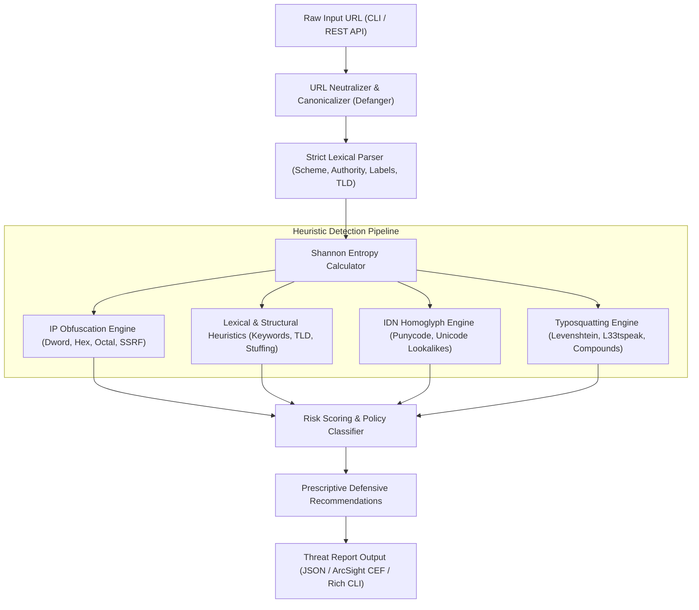

# Phishing URL Analyzer — Architecture & Design

## 1. System Overview

The **Phishing URL & Domain Threat Intelligence Analyzer** is a defensive cybersecurity engine designed to evaluate suspect URLs and domain names for deception techniques without executing outbound HTTP connections or DNS requests.

---

## 2. Component Deconstruction

### 2.1 Canonicalization & Defanging (`core/defanger.py`)
- Neutralizes active URLs to prevent accidental clicks in mail clients and SOC ticketing tools:
  - `http://` $\rightarrow$ `hxxp://`
  - `https://` $\rightarrow$ `hxxps://`
  - `.` $\rightarrow$ `[.]`
  - `:` $\rightarrow$ `[:]` (IPv6 addresses)
- Handles bidirectional refanging for internal parsing.

### 2.2 Shannon Entropy Engine (`core/entropy.py`)
- Evaluates token randomness via information theory formula:
  $$H(X) = -\sum_{i=1}^{n} P(x_i) \log_2 P(x_i)$$
- Differentiates human-readable names ($H < 3.5$) from Algorithmically Generated Domains (DGAs) and cryptographic tokens ($H \ge 4.0$).

### 2.3 IP Obfuscation & SSRF Engine (`detection/ip_obfuscation.py`)
- Unpacks non-canonical IP formats:
  - **Dword Integer IPs**: `http://2130706433` $\rightarrow$ `127.0.0.1`
  - **Hexadecimal IPs**: `http://0x7f000001` or `http://0x7f.0.0.1` $\rightarrow$ `127.0.0.1`
  - **Octal IPs**: `http://0177.0.0.1` $\rightarrow$ `127.0.0.1`
- Flags RFC 1918 private IP ranges, loopback (`127.0.0.0/8`), link-local (`169.254.0.0/16`), and carrier-grade NAT blocks to identify SSRF attempts.

### 2.4 Homoglyph & Punycode Engine (`detection/homoglyph.py`)
- Analyzes Internationalized Domain Names (IDNs) and Punycode labels (`xn--...`).
- Normalizes Cyrillic, Greek, and Unicode lookalikes (e.g. Cyrillic `а` $\rightarrow$ Latin `a`).
- Compares normalized strings against protected brand assets to uncover visual brand impersonation.

### 2.5 Typosquatting & Bitsquatting Engine (`detection/typosquat.py`)
- Implements an $O(\min(M, N))$ space-efficient Levenshtein distance algorithm.
- Uncovers l33tspeak substitutions (`paypa1`, `g00gle`, `amaz0n`).
- Catches compound SLDs (`paypal-security-update.com`) and subdomain masking (`paypal.com.attacker.net`).

### 2.6 Scoring & Policy Classifier (`scoring/engine.py`)
- Aggregates severity weights with critical floor escalation:
  - $\ge 70$: **MALICIOUS**
  - $40 - 69$: **SUSPICIOUS**
  - $< 40$: **BENIGN**
- Exports findings to ArcSight Common Event Format (CEF) for SIEM ingestion.
